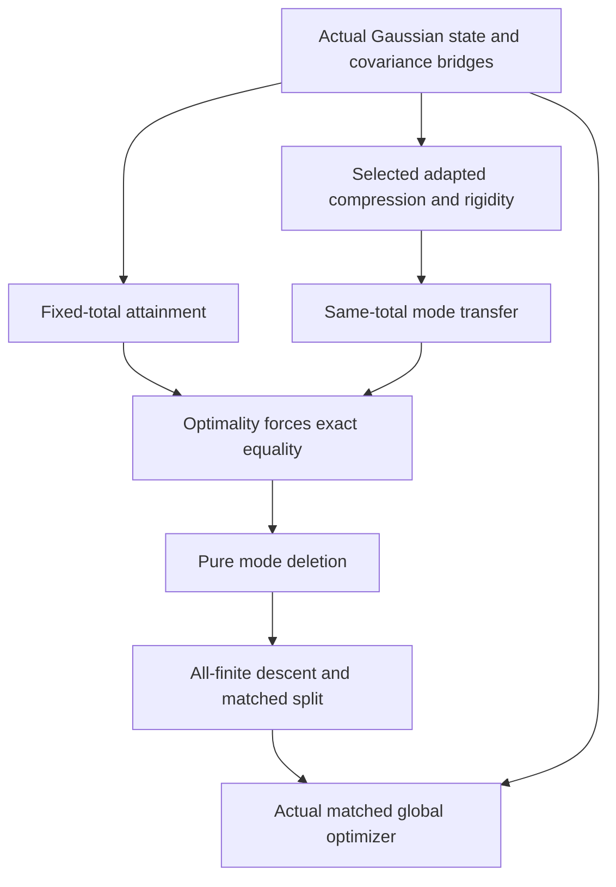

# Formal verification appendix: finite-mode Gaussian minimum purification

**Version 1.0.0 · 13 October 2026 · prepared for external mathematical-physics review**  
Companion to Dehao Lin, *A Mode Bound for Gaussian Entanglement of Purification*, scientific manuscript v0.1.1, and the source-only Lean project distributed in repository release v0.1.3. Prepared with AI assistance; this document supplies a statement crosswalk and review interfaces, not a human certification or a new mathematical proof. Documentation is licensed CC BY 4.0 under the repository licensing terms.

## A. Citation, frozen inputs and status

For citation use: **“Formal verification appendix: finite-mode Gaussian minimum purification, v1.0.0, 13 October 2026,”** together with this file's Git commit, the manuscript v0.1.1 tag, and Lean v0.1.3 tag. This appendix has no DOI and does not change either release version. Its companion [exact statement dossier](STATEMENTS.md) and [machine-readable declaration index](declarations.json) are integral parts of the crosswalk.

| Input | Immutable identity | Role |
| --- | --- | --- |
| Scientific manuscript v0.1.1 | [`313c3e8ac67463388c36a4094a42f40aec8a3aa6`](https://github.com/LeoLam233/gaussian-minimum-purification/tree/313c3e8ac67463388c36a4094a42f40aec8a3aa6) | Theorem 2.1, Lemma 3.1, Propositions 4.1–4.2, Lemma 4.3, §5, Appendices A–C |
| Lean repository v0.1.3 | [`62820a0afff79559be7c3af99cc23a8c7550ac5c`](https://github.com/LeoLam233/gaussian-minimum-purification/tree/62820a0afff79559be7c3af99cc23a8c7550ac5c/formalization) | 308 Lean source files in the 313-file protected project |
| Integration review base | [`0e04a7bcd0bfb27e2a87dcb8be81bdaa71242dda`](https://github.com/LeoLam233/gaussian-minimum-purification/commit/0e04a7bcd0bfb27e2a87dcb8be81bdaa71242dda) | Current main inspected for documentation integration; 4 October bibliography/ORCID maintenance |

The historical [v0.1.1 PDF](https://github.com/LeoLam233/gaussian-minimum-purification/blob/313c3e8ac67463388c36a4094a42f40aec8a3aa6/paper/manuscript.pdf) and [TeX source](https://github.com/LeoLam233/gaussian-minimum-purification/blob/313c3e8ac67463388c36a4094a42f40aec8a3aa6/paper/manuscript.tex) are the paper reference here. Current main's paper files have different hashes because of the recorded bibliography/ORCID maintenance. Direct source comparison confirms that the block from §2 through the end of the mathematical Appendices A–C is unchanged. No historical paper, original proof artifact, expert-brief PDF or protected Lean file is edited by this appendix. The [input receipt](INPUTS.json) binds the inspected bytes and states the checks actually performed.

Recorded reproducibility evidence is already documented in [LEAN_FORMALIZATION.md](../LEAN_FORMALIZATION.md) and [LEAN_FORMALIZATION_SOURCE.json](../../provenance/LEAN_FORMALIZATION_SOURCE.json): an independent Codex source replay rebuilt 308 Gaussian and 74 selected Physlib modules; the two physical root declarations reported only `propext`, `Classical.choice`, `Quot.sound`. This appendix does **not** claim a new source compilation, independent blind audit, or expert approval. Kernel acceptance checks a formal proposition under its definitions; the mathematical-physics reviewer must still check that those definitions and the proposition express the intended physical problem.

## B. The exact physical contract

Fix independently finite physical counts \(n_A,n_B\in\mathbb N\), including zero, and a Gaussian physical density \(\rho_{AB}\). The result is the existence of an actual pure Gaussian extension \(\sigma\) with **each** auxiliary count matched, \(m_A=n_A\), \(m_B=n_B\), such that

\[
 S(\sigma_{AA'})=\inf_{m_A,m_B\in\mathbb N}\{S(\tau_{AA'}):\tau\text{ pure Gaussian},\ \tau_{AB}=\rho_{AB}\},
 \qquad S(\sigma_{AA'})\le S(\tau_{AA'})
\]

for every admissible finite-pair competitor. The quantified comparison is part of each root, so the statement is stronger than equal numerical values at two chosen auxiliary sizes. The optimizer is a state, not merely a covariance or an infimizing sequence.

| Sector | Exact input and admissibility | Actual objective and conclusion | Explicit boundary |
| --- | --- | --- | --- |
| Boson (B01) | `ρ : BipartiteDensity nA nB`, `IsGaussian ρ`; `IsSidewisePurifier ρ σ` means `IsPureGaussian σ ∧ σ.leftReduction = ρ` | `sidewiseEntropy : ENNReal`, true AA′ reduced-state entropy; matched witness has entropy `≠ ⊤`, equals `gaussianPurificationInfimum`, and is ≤ every admissible finite-pair entropy | Normal densities on full finite-configuration Schrödinger L² spaces; finite real mean and covariance. Arbitrary finite squeezing, pure/repeated normal parameters and zero parties included. Infinite-mode, nonnormal or singular infinite-squeezing limits excluded |
| Fermion (F01) | `ρ : Density (nA+nB)`, `IsQuasifree ρ`; `IsSidewisePurifier` means `IsPureQuasifree σ ∧ prefixRestriction ... σ = ρ` | `sidewiseEntropy : ℝ`, ordinary finite-density von Neumann entropy after signed complete-mode reordering; actual matched witness and universal finite-pair comparison | Full finite occupation space; parity-invariant Wick inputs; both definite total parities of pure extensions allowed. Zero/repeated covariance parameters, pure endpoints and empty system included. No separately prescribed-total-parity root |

The bosonic root adds explicit finiteness because the ambient density entropy may be infinite. The fermionic density lives in a \(2^N\)-dimensional occupation space, so the ordinary real entropy is appropriate. These differing codomains must not be conflated. Logarithms are natural; the paper's vacuum covariance is \(I\), bosonic normal parameters satisfy \(\nu\ge1\), and fermionic normal parameters satisfy \(0\le\lambda\le1\).

**Theorem 2.1 corresponds to B01 and F01.** Their complete literal statement headers are in the dossier. Their only explicit mathematical input is the specified actual Gaussian/Wick state and finite counts. Attainment, compression, realization and deletion are proved on the way to these roots, rather than additional assumptions at the roots.

## C. Semantic bridges that require physical review

The most useful geometric image is a selected complex line \(P\subset C\cap JC\), with the entire physical coefficient space retained. Compression changes the cut; it does not yet remove a physical mode. Equality at an attained same-total optimum makes this selected line pure, after which deletion preserves the extension. The bridge from that coefficient geometry to the **actual reduced state** is load-bearing.

| Paper object | Lean definition / module at frozen v0.1.3 | Meaning to check |
| --- | --- | --- |
| Bosonic physical state | [`NormalDensity`](https://github.com/LeoLam233/gaussian-minimum-purification/blob/62820a0afff79559be7c3af99cc23a8c7550ac5c/formalization/Gaussian/Physical/Boson/NormalDensity.lean) and [`Schrodinger`](https://github.com/LeoLam233/gaussian-minimum-purification/blob/62820a0afff79559be7c3af99cc23a8c7550ac5c/formalization/Gaussian/Physical/Boson/Weyl.lean) | Positive trace-class operator, trace one; purity is equality to a normalized vector density. Configuration finite, L² Hilbert space not truncated |
| Bosonic Gaussianity and normalization | [`IsGaussianWith`](https://github.com/LeoLam233/gaussian-minimum-purification/blob/62820a0afff79559be7c3af99cc23a8c7550ac5c/formalization/Gaussian/Physical/Boson/GaussianPredicate.lean), [`IsGaussian`](https://github.com/LeoLam233/gaussian-minimum-purification/blob/62820a0afff79559be7c3af99cc23a8c7550ac5c/formalization/Gaussian/Physical/Boson/GaussianState.lean), [`weylSymplecticForm`](https://github.com/LeoLam233/gaussian-minimum-purification/blob/62820a0afff79559be7c3af99cc23a8c7550ac5c/formalization/Gaussian/Physical/Boson/WeylSymplectic.lean) | Symmetric real V and actual Weyl characteristic `exp(i*m(q,p) − V((q,p),(q,p))/4)`. Weyl coefficients use translation/modulation convention, with m(q,p)=p·dQ+q·dP; compare coefficient forms, not an unexamined raw matrix ordering |
| Bosonic entropy | [`NormalDensity.entropyOperator` / `entropy`](https://github.com/LeoLam233/gaussian-minimum-purification/blob/62820a0afff79559be7c3af99cc23a8c7550ac5c/formalization/Gaussian/Physical/Boson/NormalEntropy.lean) | Positive CFC operator −ρ log ρ, trace norm when trace class and ∞ otherwise; B25 identifies its trace, B03 proves Gaussian finiteness and covariance cost equality |
| Bosonic physical marginal and cut | [`sidewiseReduction`, `sidewiseEntropy`, `IsSidewisePurifier`](https://github.com/LeoLam233/gaussian-minimum-purification/blob/62820a0afff79559be7c3af99cc23a8c7550ac5c/formalization/Gaussian/Physical/Boson/SidewiseDomain.lean) | Actual configuration reorder and left partial trace. B05 connects characteristic, mean and covariance restriction. B06 maps every competitor to raw covariance; B07 returns an actual state with exact counts and objective |
| Bosonic raw optimization | [`BosonicCovariancePurifier`, `cost`, `leftModes`, `rightModes`](https://github.com/LeoLam233/gaussian-minimum-purification/blob/62820a0afff79559be7c3af99cc23a8c7550ac5c/formalization/Gaussian/Phase/BosonicPurificationDomain.lean) | Finite auxiliary carrier with nondegenerate alternating form and dimension 2M, compatible pure covariance, exact physical restriction, nondegenerate auxiliary split. No minimum or entropy equality stored as a field |
| Fermionic density and observables | [`Occupation`, `Density`, Majoranas](https://github.com/LeoLam233/gaussian-minimum-purification/blob/62820a0afff79559be7c3af99cc23a8c7550ac5c/formalization/Gaussian/Physical/Fermion/MatrixModel.lean), [`moment`, `covariance`](https://github.com/LeoLam233/gaussian-minimum-purification/blob/62820a0afff79559be7c3af99cc23a8c7550ac5c/formalization/Gaussian/Physical/Fermion/Covariance.lean) | Recursive complete occupation basis, signed Majorana operators and trace-defined Γ=−i⟨[c,c]⟩/2, rather than independent arbitrary matrices |
| Fermionic Gaussianity and purity | [`IsQuasifree`, `IsPureQuasifree`](https://github.com/LeoLam233/gaussian-minimum-purification/blob/62820a0afff79559be7c3af99cc23a8c7550ac5c/formalization/Gaussian/Physical/Fermion/Quasifree.lean) | Parity invariance and Wick rule for every Majorana word; actual vector-density purity added separately. No entropy or minimum stored in Gaussianity |
| Fermionic covariance and entropy | [`covarianceGenerator`](https://github.com/LeoLam233/gaussian-minimum-purification/blob/62820a0afff79559be7c3af99cc23a8c7550ac5c/formalization/Gaussian/Physical/Fermion/CovarianceOperator.lean), F02–F05 | Proved raw realization, covariance uniqueness, density entropy formula and purity criterion. Repeated and zero modes require no inverse of Γ |
| Fermionic physical marginal and cut | [`sidewiseUnitary`, `sidewiseRestriction`, `sidewiseEntropy`, `IsSidewisePurifier`](https://github.com/LeoLam233/gaussian-minimum-purification/blob/62820a0afff79559be7c3af99cc23a8c7550ac5c/formalization/Gaussian/Physical/Fermion/SidewiseDomain.lean) | Whole-mode permutation acts on pairs of Majoranas, implemented by actual signed CAR unitary; then actual density partial trace and Sᵥₙ. Numeric dependent-type sums must not be mistaken for an unsigned occupation relabeling |
| Optimization over all finite pairs | [`Boson.AllFiniteDomain`](https://github.com/LeoLam233/gaussian-minimum-purification/blob/62820a0afff79559be7c3af99cc23a8c7550ac5c/formalization/Gaussian/Physical/Boson/AllFiniteDomain.lean), [`Fermion.AllFiniteDomain`](https://github.com/LeoLam233/gaussian-minimum-purification/blob/62820a0afff79559be7c3af99cc23a8c7550ac5c/formalization/Gaussian/Physical/Fermion/AllFiniteDomain.lean) | Cost set existentially ranges over mA,mB : ℕ; its sInf is the named Gaussian infimum. F19 proves equivalence to finite-total coding; root comparisons are directly over all actual pairs |

The bosonic two-form objective restricts **both V and Ω**. A noncanonical coefficient frame does not permit using V alone as though Ω were canonical. B09 and the coordinate transports justify the actual spectrum correspondence; B06 and B07 close both directions of the state/covariance optimization bridge. The Gaussianity definition is a characteristic-function predicate; interpreting V as the paper's physical covariance uses its Weyl normalization and uncertainty/normal-form theorems, not a definitionally attached entropy formula.

For fermions, Wick uniqueness F03 uses the full Majorana-word span. A covariance-only identification without quasifreeness would be insufficient. F04 derives the ordinary entropy objective, F05 connects covariance purity to actual state purity, and F08 constructs the selected actual complete-mode restriction. The formalized orthogonal implementation interfaces allow the parity components admitted in the main domain; they do not give the optional prescribed-parity optimizer theorem.

## D. Proof flow and exact correspondence



This is a dependency guide, not a claim that each arrow is one Lean declaration. The tables below give the actual interfaces; the dossier reproduces all binders and conclusions with module hashes and frozen line links. Hypothesis summaries supplement, and never replace, those exact source statements.

### D.1 Bosonic interfaces

| ID / paper node | Lean declaration and source | Assumptions; coverage boundary |
| --- | --- | --- |
| [B01](STATEMENTS.md#b01) / Theorem 2.1 | [`Gaussian.Physical.Boson.exists_matched_global_gaussian_purification`](https://github.com/LeoLam233/gaussian-minimum-purification/blob/62820a0afff79559be7c3af99cc23a8c7550ac5c/formalization/Gaussian/Physical/Boson/GlobalMinimum.lean#L17-L23) | nA,nB : ℕ; ρ : BipartiteDensity nA nB; IsGaussian ρ. **Scope:** Actual matched pure Gaussian witness; finite ENNReal entropy, equality to all-finite infimum, comparison with every finite pair. No non-Gaussian comparison. |
| [B02](STATEMENTS.md#b02) / §2 covariance conventions; semantic input | [`Gaussian.Physical.Boson.existsUnique_gaussian_iff`](https://github.com/LeoLam233/gaussian-minimum-purification/blob/62820a0afff79559be7c3af99cc23a8c7550ac5c/formalization/Gaussian/Physical/Boson/GaussianEntropyObjective.lean#L14-L16) | Finite real configuration Hilbert space with Borel measurable structure; arbitrary finite linear mean m and real bilinear V. **Scope:** Realizability and uniqueness iff V symmetric and RealifiedUncertainty. No nonnormal or infinite-mode representation. |
| [B03](STATEMENTS.md#b03) / §2 entropy formula | [`Gaussian.Physical.Boson.IsGaussianWith.entropy_objective`](https://github.com/LeoLam233/gaussian-minimum-purification/blob/62820a0afff79559be7c3af99cc23a8c7550ac5c/formalization/Gaussian/Physical/Boson/GaussianEntropyObjective.lean#L26-L31) | Same configuration assumptions; finite index type and basis e of E×E; actual density with IsGaussianWith ρ m V. **Scope:** Proves entropy ≠ top before toReal equals bosonFormCost. Not an entropy identity for arbitrary densities. |
| [B04](STATEMENTS.md#b04) / §2 pure covariance semantics | [`Gaussian.Physical.Boson.IsGaussianWith.isPure_iff_exists_pureCompatible`](https://github.com/LeoLam233/gaussian-minimum-purification/blob/62820a0afff79559be7c3af99cc23a8c7550ac5c/formalization/Gaussian/Physical/Boson/GaussianPurity.lean#L75-L78) | Same configuration assumptions; actual IsGaussianWith ρ m V. **Scope:** Pure actual state iff compatible pure covariance with form V; Gaussianity required. |
| [B05](STATEMENTS.md#b05) / §2 actual subsystem semantics | [`Gaussian.Physical.Boson.IsGaussianWith.sidewiseReduction`](https://github.com/LeoLam233/gaussian-minimum-purification/blob/62820a0afff79559be7c3af99cc23a8c7550ac5c/formalization/Gaussian/Physical/Boson/SidewiseDomain.lean#L51-L57) | Finite configurations A,B,C,D; actual four-party IsGaussianWith σ m V. **Scope:** True AA′ reduction has restricted mean and covariance; complete subsystem, not arbitrary coefficient deletion. |
| [B06](STATEMENTS.md#b06) / Theorem 2.1 comparison domain | [`Gaussian.Physical.Boson.IsSidewisePurifier.exists_covariancePurifier`](https://github.com/LeoLam233/gaussian-minimum-purification/blob/62820a0afff79559be7c3af99cc23a8c7550ac5c/formalization/Gaussian/Physical/Boson/CovarianceDomainBridge.lean#L23-L32) | Finite configurations A,B,C,D; input IsGaussianWith ρ m V; σ an actual IsSidewisePurifier of ρ. **Scope:** Every actual competitor yields raw covariance purifier, exact two counts and finite equal cost. Essential converse direction; no bound on competitor counts. |
| [B07](STATEMENTS.md#b07) / Theorem 2.1 witness realization | [`Gaussian.Physical.Boson.covariancePurifier_exists_sidewise_realization`](https://github.com/LeoLam233/gaussian-minimum-purification/blob/62820a0afff79559be7c3af99cc23a8c7550ac5c/formalization/Gaussian/Physical/Boson/CovarianceDomainRealization.lean#L15-L24) | Finite A,B; input IsGaussianWith ρ m V; M : ℕ; raw BosonicCovariancePurifier V Ω M for the Weyl form. **Scope:** Actual purifier with exact side counts and cost; physical mean preserved. Does not assert unique optimizer. |
| [B08](STATEMENTS.md#b08) / Lemma 3.1, §3.2 | [`Gaussian.Phase.exists_bosonic_product_selection`](https://github.com/LeoLam233/gaussian-minimum-purification/blob/62820a0afff79559be7c3af99cc23a8c7550ac5c/formalization/Gaussian/Phase/BosonicPurificationProductSelection.lean#L31-L47) | Finite real modules E,F; symmetric V on E×F; alternating nondegenerate Ω,σ; product uncertainty; finrank E < finrank F. **Scope:** Selected auxiliary plane, symplectic complement, nonincrease, equality implies pure plane covariance. Covariance statement, not standalone physical factorization iff. |
| [B09](STATEMENTS.md#b09) / §3.2 actual restricted spectrum | [`Gaussian.Phase.BosonicAdaptationData.restricted_formCost_eq_half_spectrum`](https://github.com/LeoLam233/gaussian-minimum-purification/blob/62820a0afff79559be7c3af99cc23a8c7550ac5c/formalization/Gaussian/Phase/BosonicPurificationCompression.lean#L32-L41) | BosonicAdaptationData d for V,Ω; Ω alternating; g ≤ V as quadratic forms; U J-invariant; dim U=2m; mode basis e. **Scope:** Both restricted forms equal genuine adapted-metric compression cost. U need not be K-invariant; arbitrary non-J-invariant U excluded. |
| [B10](STATEMENTS.md#b10) / Lemma 3.1 inequality | [`Gaussian.Phase.BosonicAdaptationData.restricted_formCost_le`](https://github.com/LeoLam233/gaussian-minimum-purification/blob/62820a0afff79559be7c3af99cc23a8c7550ac5c/formalization/Gaussian/Phase/BosonicPurificationRigidity.lean#L27-L31) | Finite real module; adaptation d; alternating Ω; g≤V; J-invariant U; full and retained Boolean mode bases. **Scope:** Covariance cost comparison. Actual entropy needs B03 and subsystem bridges. |
| [B11](STATEMENTS.md#b11) / Lemma 3.1 equality | [`Gaussian.Phase.BosonicAdaptationData.restricted_formCost_rigidity`](https://github.com/LeoLam233/gaussian-minimum-purification/blob/62820a0afff79559be7c3af99cc23a8c7550ac5c/formalization/Gaussian/Phase/BosonicPurificationRigidity.lean#L49-L55) | B10 hypotheses plus exact equality of the two form costs. **Scope:** K=I on true symplectic complement and zero V cross block. Approximate equality and arbitrary deletion excluded. |
| [B12](STATEMENTS.md#b12) / Lemma 3.1 pure endpoint | [`Gaussian.Phase.BosonicAdaptationData.exists_pure_discarded_of_formCost_eq`](https://github.com/LeoLam233/gaussian-minimum-purification/blob/62820a0afff79559be7c3af99cc23a8c7550ac5c/formalization/Gaussian/Phase/BosonicPurificationRigidity.lean#L103-L110) | B10 hypotheses plus exact cost equality. **Scope:** Constructs PureCompatibleCovariance on the discarded complement; physical realization is separate. |
| [B13](STATEMENTS.md#b13) / Proposition 4.1 and Appendix A | [`Gaussian.Phase.exists_pure_covariance_auxiliary_equiv`](https://github.com/LeoLam233/gaussian-minimum-purification/blob/62820a0afff79559be7c3af99cc23a8c7550ac5c/formalization/Gaussian/Phase/BosonicPurificationCrossOrbit.lean#L15-L24) | Finite real E,F,G; Ω nondegenerate; two compatible pure covariances for product forms; equal auxiliary dimensions and identical physical covariance. **Scope:** Actual auxiliary symplectic equivalence of whole covariances, including uncoupled pure factors. Covariance orbit, not a separately named physical-unitary orbit theorem. |
| [B14](STATEMENTS.md#b14) / Proposition 4.2 and Lemma 4.3 | [`Gaussian.Phase.PureCompatibleCovariance.exists_auxiliarySubspaceCost_minimum`](https://github.com/LeoLam233/gaussian-minimum-purification/blob/62820a0afff79559be7c3af99cc23a8c7550ac5c/formalization/Gaussian/Phase/BosonicPurificationSubspaceMinimum.lean#L17-L24) | Finite real E,F; compatible pure p; nondegenerate physical A; existing k-dimensional nondegenerate auxiliary cut S₀. **Scope:** Attains minimum over every nondegenerate cut of that dimension. Does not assume compactness of the open symplectic-cut locus. |
| [B15](STATEMENTS.md#b15) / Lemma 4.3, §4 boundary estimate | [`Gaussian.Attainment.exists_bosonPairCost_minimum`](https://github.com/LeoLam233/gaussian-minimum-purification/blob/62820a0afff79559be7c3af99cc23a8c7550ac5c/formalization/Gaussian/Attainment/PairCompactness.lean#L62-L67) | Finite matrix index; compact family F; continuous Hermitian V,O; V positive definite on F; admissible p₀∈F with det O(p₀)≠0. **Scope:** Minimum on nondegenerate locus; inverse-form bound proved on finite cost sublevel. No uniform bound over all squeezing or auxiliary totals. |
| [B16](STATEMENTS.md#b16) / Lemma 4.3 | [`Gaussian.Phase.exists_bosonic_covariance_fixedTotal_minimum`](https://github.com/LeoLam233/gaussian-minimum-purification/blob/62820a0afff79559be7c3af99cc23a8c7550ac5c/formalization/Gaussian/Phase/BosonicPurificationDomainMinimum.lean#L17-L23) | Symmetric V; alternating nondegenerate Ω; uncertainty; nondegenerate physical A; finite M with finrank E≤2M. **Scope:** Minimum over full raw fixed-total domain and all nondegenerate splits. Existence not asserted for every undersized M. |
| [B17](STATEMENTS.md#b17) / §5 transfer A′→B′ | [`Gaussian.Phase.BosonicCovariancePurifier.exists_move_left`](https://github.com/LeoLam233/gaussian-minimum-purification/blob/62820a0afff79559be7c3af99cc23a8c7550ac5c/formalization/Gaussian/Phase/BosonicPurificationDomainMoves.lean#L46-L50) | Raw purifier p at M; Ω alternating; nondegenerate physical A; finrank A<2*p.leftModes. **Scope:** Same total and marginal, left count decreases one, cost nonincreases. No deletion yet; name left means reducing left count. |
| [B18](STATEMENTS.md#b18) / §5 transfer B′→A′ | [`Gaussian.Phase.BosonicCovariancePurifier.exists_move_right`](https://github.com/LeoLam233/gaussian-minimum-purification/blob/62820a0afff79559be7c3af99cc23a8c7550ac5c/formalization/Gaussian/Phase/BosonicPurificationDomainMoves.lean#L71-L76) | Raw p at M; alternating nondegenerate Ω; nondegenerate A; finrank(Ω.orthogonal A)<2*p.rightModes. **Scope:** Same total, left count increases one, nonincreasing cost via complementary pure-cut equality. |
| [B19](STATEMENTS.md#b19) / §5 equality then removal | [`Gaussian.Phase.BosonicCovariancePurifier.exists_delete_left_at_minimum`](https://github.com/LeoLam233/gaussian-minimum-purification/blob/62820a0afff79559be7c3af99cc23a8c7550ac5c/formalization/Gaussian/Phase/BosonicPurificationDomainDelete.lean#L17-L21) | Raw p at M+1; Ω alternating; nondegenerate physical A; strict left excess; exact global minimum among all fixed-(M+1) raw purifiers. **Scope:** Deletes selected globally invariant pure auxiliary plane at exactly equal cost. A minimum only within one split is insufficient. |
| [B20](STATEMENTS.md#b20) / §5 either-side removal | [`Gaussian.Phase.BosonicCovariancePurifier.exists_delete_at_minimum`](https://github.com/LeoLam233/gaussian-minimum-purification/blob/62820a0afff79559be7c3af99cc23a8c7550ac5c/formalization/Gaussian/Phase/BosonicPurificationDomainDelete.lean#L75-L80) | Raw p at M+1; alternating nondegenerate Ω; nondegenerate A; finrank E≤2M; exact fixed-total minimum. **Scope:** One-step reduction to M with no greater cost; either excessive side. Does not delete from arbitrary nonoptimal states. |
| [B21](STATEMENTS.md#b21) / §5 padding smaller totals | [`Gaussian.Phase.BosonicCovariancePurifier.pad_cost`](https://github.com/LeoLam233/gaussian-minimum-purification/blob/62820a0afff79559be7c3af99cc23a8c7550ac5c/formalization/Gaussian/Phase/BosonicPurificationAuxPadding.lean#L133-L135) | Raw p at M; M≤N; physical A with nondegenerate restricted Ω. **Scope:** Finite pure padding preserves cost exactly; no infinite-dimensional padding theorem. |
| [B22](STATEMENTS.md#b22) / Theorem 2.1 covariance core | [`Gaussian.Phase.exists_bosonic_covariance_allFinite_matched_minimum`](https://github.com/LeoLam233/gaussian-minimum-purification/blob/62820a0afff79559be7c3af99cc23a8c7550ac5c/formalization/Gaussian/Phase/BosonicPurificationMinimum.lean#L21-L28) | Symmetric uncertainty-admissible V; alternating nondegenerate Ω; nondegenerate A; dim E=2(nA+nB), dim A=2nA. **Scope:** Matched raw witness compared with every finite raw auxiliary total/carrier/split. Actual states follow B06/B07. |
| [B23](STATEMENTS.md#b23) / Theorem 2.1 infimum identification | [`Gaussian.Physical.Boson.infimum_eq_of_global_sidewise_witness`](https://github.com/LeoLam233/gaussian-minimum-purification/blob/62820a0afff79559be7c3af99cc23a8c7550ac5c/formalization/Gaussian/Physical/Boson/AllFiniteDomain.lean#L24-L29) | Actual feasible σ at finite pair; comparison with every actual finite sidewise purifier. **Scope:** Identifies ENNReal infimum with witness entropy. Finiteness is separately provided by B01/B03. |
| [B24](STATEMENTS.md#b24) / Lemma 3.1 factor semantics | [`Gaussian.Physical.Boson.IsGaussianWith.eq_product_of_cross_zero`](https://github.com/LeoLam233/gaussian-minimum-purification/blob/62820a0afff79559be7c3af99cc23a8c7550ac5c/formalization/Gaussian/Physical/Boson/GaussianFactorization.lean#L50-L56) | Finite configuration E,F; actual Gaussian density with mean m and covariance V; all cross covariance entries zero. **Scope:** Actual density is product of actual left and right reductions. Gaussianity and full cross-block hypothesis required. |
| [B25](STATEMENTS.md#b25) / §2 actual entropy semantics | [`Gaussian.Physical.Boson.NormalDensity.entropy_eq_of_traceClass`](https://github.com/LeoLam233/gaussian-minimum-purification/blob/62820a0afff79559be7c3af99cc23a8c7550ac5c/formalization/Gaussian/Physical/Boson/NormalEntropy.lean#L52-L54) | Complete complex Hilbert space; positive normalized trace-class NormalDensity; entropyOperator trace class. **Scope:** Extended entropy equals real trace of CFC −ρ log ρ. General normal-density bridge; Gaussian finiteness is proved separately. |

### D.2 Fermionic interfaces

| ID / paper node | Lean declaration and source | Assumptions; coverage boundary |
| --- | --- | --- |
| [F01](STATEMENTS.md#f01) / Theorem 2.1 | [`Gaussian.Physical.Fermion.exists_matched_global_gaussian_purification`](https://github.com/LeoLam233/gaussian-minimum-purification/blob/62820a0afff79559be7c3af99cc23a8c7550ac5c/formalization/Gaussian/Physical/Fermion/GlobalMinimum.lean#L14-L21) | nA,nB : ℕ; ρ : Density (nA+nB); IsQuasifree ρ. **Scope:** Actual matched pure Wick density; real entropy equals all-finite infimum, comparison with every finite pair. Both parity components; no prescribed-parity conclusion. |
| [F02](STATEMENTS.md#f02) / §2 and Appendix A normal-form semantics | [`Gaussian.Physical.Fermion.realize_skew_contraction`](https://github.com/LeoLam233/gaussian-minimum-purification/blob/62820a0afff79559be7c3af99cc23a8c7550ac5c/formalization/Gaussian/Physical/Fermion/RawRealization.lean#L62-L65) | n : ℕ; real coefficient generator T skew symmetric and ‖T x‖≤‖x‖ for every x. **Scope:** Actual Wick density realizes raw contraction; no non-quasifree Gaussianity claim. |
| [F03](STATEMENTS.md#f03) / §3.1 covariance determines state | [`Gaussian.Physical.Fermion.quasifree_eq_of_generator`](https://github.com/LeoLam233/gaussian-minimum-purification/blob/62820a0afff79559be7c3af99cc23a8c7550ac5c/formalization/Gaussian/Physical/Fermion/RawRealization.lean#L76-L78) | Two actual quasifree densities of the same size; identical covariance generators. **Scope:** Equality of densities, using complete word span; covariance alone insufficient outside Wick class. |
| [F04](STATEMENTS.md#f04) / §2 entropy formula | [`Gaussian.Physical.Fermion.quasifree_entropy_eq_hermitianCost`](https://github.com/LeoLam233/gaussian-minimum-purification/blob/62820a0afff79559be7c3af99cc23a8c7550ac5c/formalization/Gaussian/Physical/Fermion/OrthogonalSpectrum.lean#L92-L93) | n : ℕ; ρ : Density n; IsQuasifree ρ. **Scope:** Actual von Neumann entropy equals covariance Hermitian cost; includes zero/repeated/pure endpoints. |
| [F05](STATEMENTS.md#f05) / §3.1 pure endpoint | [`Gaussian.Physical.Fermion.quasifree_pure_iff_covariancePure`](https://github.com/LeoLam233/gaussian-minimum-purification/blob/62820a0afff79559be7c3af99cc23a8c7550ac5c/formalization/Gaussian/Physical/Fermion/PurityBridge.lean#L59-L60) | n : ℕ; actual density ρ; IsQuasifree ρ. **Scope:** Pure vector density iff generator squares to −I. No chosen total parity. |
| [F06](STATEMENTS.md#f06) / Lemma 3.1, §3.1 | [`Gaussian.Physical.Fermion.quasifree_entropy_comparison_of_compression`](https://github.com/LeoLam233/gaussian-minimum-purification/blob/62820a0afff79559be7c3af99cc23a8c7550ac5c/formalization/Gaussian/Physical/Fermion/CompressionBridge.lean#L68-L74) | Actual quasifree ρ,σ; skew adaptation d; invariant retained V; isometry e to V; exact compressed-generator intertwining hT. **Scope:** Entropy comparison for actual states once subsystem generator is identified. Not every deletion satisfies hT or invariance. |
| [F07](STATEMENTS.md#f07) / Lemma 3.1 equality | [`Gaussian.Physical.Fermion.quasifree_compression_entropy_rigidity`](https://github.com/LeoLam233/gaussian-minimum-purification/blob/62820a0afff79559be7c3af99cc23a8c7550ac5c/formalization/Gaussian/Physical/Fermion/CompressionRigidity.lean#L12-L19) | F06 hypotheses plus exact equality Sᵥₙ σ=Sᵥₙ ρ. **Scope:** K=I on discarded orthogonal complement and zero K cross block; no approximate rigidity. |
| [F08](STATEMENTS.md#f08) / Lemma 3.1 selected local mode | [`Gaussian.Physical.Fermion.exists_counted_entropy_selection`](https://github.com/LeoLam233/gaussian-minimum-purification/blob/62820a0afff79559be7c3af99cc23a8c7550ac5c/formalization/Gaussian/Physical/Fermion/CountedCutSelection.lean#L26-L36) | a,k : ℕ; 2*a<1+k; ρ : Density (1+k); IsQuasifree ρ. **Scope:** Constructs implemented orthogonal action fixing a protected complete modes; restriction lowers entropy, equality implies actual pure suffix. Inequality is strict excess c>a with c=1+k−a. |
| [F09](STATEMENTS.md#f09) / Lemma 4.3 alternate formal route | [`Gaussian.Physical.Fermion.isCompact_quasifreePurifiers`](https://github.com/LeoLam233/gaussian-minimum-purification/blob/62820a0afff79559be7c3af99cc23a8c7550ac5c/formalization/Gaussian/Physical/Fermion/StateTopology.lean#L62-L63) | k,l : ℕ; fixed actual density ρ : Density k. **Scope:** Compact actual pure-quasifree fixed-marginal domain; may be empty. Formal route uses density compactness, not manuscript Grassmannian orbit proof. |
| [F10](STATEMENTS.md#f10) / Lemma 4.3 fixed split | [`Gaussian.Physical.Fermion.exists_sidewise_minimum`](https://github.com/LeoLam233/gaussian-minimum-purification/blob/62820a0afff79559be7c3af99cc23a8c7550ac5c/formalization/Gaussian/Physical/Fermion/SidewiseDomain.lean#L68-L72) | Finite nA,nB,mA,mB; fixed density ρ; explicit nonempty sidewise purifier class. **Scope:** Attains actual entropy at this split. Nonemptiness is required, not silently inferred for undersized auxiliaries. |
| [F11](STATEMENTS.md#f11) / Lemma 4.3 all splits | [`Gaussian.Physical.Fermion.finitePurifier_attainment`](https://github.com/LeoLam233/gaussian-minimum-purification/blob/62820a0afff79559be7c3af99cc23a8c7550ac5c/formalization/Gaussian/Physical/Fermion/FiniteTotalDomain.lean#L24-L27) | Input quasifree ρ; finite M≥nA+nB. **Scope:** Actual fixed-total minimum including every split; nonemptiness supplied by canonical purification and padding. |
| [F12](STATEMENTS.md#f12) / §5 transfer and equality | [`Gaussian.Physical.Fermion.exists_A_excess_transfer`](https://github.com/LeoLam233/gaussian-minimum-purification/blob/62820a0afff79559be7c3af99cc23a8c7550ac5c/formalization/Gaussian/Physical/Fermion/AExcessTransfer.lean#L14-L20) | nA<a+1; actual input ρ; actual sidewise purifier σ at (a+1,b). **Scope:** Actual purifier at (a,b+1) with nonincrease; exact equality gives pure transferred terminal mode. Both components allowed. |
| [F13](STATEMENTS.md#f13) / §5 opposite transfer | [`Gaussian.Physical.Fermion.exists_B_excess_transfer`](https://github.com/LeoLam233/gaussian-minimum-purification/blob/62820a0afff79559be7c3af99cc23a8c7550ac5c/formalization/Gaussian/Physical/Fermion/BExcessTransfer.lean#L11-L16) | nB<b+1; actual sidewise purifier σ at (a,b+1). **Scope:** Actual purifier at (a+1,b) with nonincrease; derived via signed party swap and complementary entropy. Public statement has no separate equality callback. |
| [F14](STATEMENTS.md#f14) / §5 / Appendix B deletion | [`Gaussian.Physical.Fermion.exists_sidewise_pure_B_entropy_deletion`](https://github.com/LeoLam233/gaussian-minimum-purification/blob/62820a0afff79559be7c3af99cc23a8c7550ac5c/formalization/Gaussian/Physical/Fermion/PureDeletion.lean#L69-L75) | Actual sidewise purifier at (mA,mB+extra); extra-mode suffix covariance pure after exact mode-count cast. **Scope:** Smaller actual pure-quasifree purifier, fixed physical density and exactly preserved cut entropy. Full signature gives terminal ordering. |
| [F15](STATEMENTS.md#f15) / §5 optimal deletion | [`Gaussian.Physical.Fermion.finitePurifier_optimal_delete`](https://github.com/LeoLam233/gaussian-minimum-purification/blob/62820a0afff79559be7c3af99cc23a8c7550ac5c/formalization/Gaussian/Physical/Fermion/OptimalDeletion.lean#L41-L46) | M≥nA+nB; actual FinitePurifier at M+1; exact minimum over all FinitePurifier at that total. **Scope:** Smaller feasible point with cost ≤ old minimum; equality follows using pure padding, not asserted by this interface alone. |
| [F16](STATEMENTS.md#f16) / §5 padding | [`Gaussian.Physical.Fermion.finitePurifier_padding`](https://github.com/LeoLam233/gaussian-minimum-purification/blob/62820a0afff79559be7c3af99cc23a8c7550ac5c/formalization/Gaussian/Physical/Fermion/FiniteTotalPadding.lean#L34-L37) | M≤L; actual FinitePurifier at M. **Scope:** Actual point at L with exactly unchanged cost; finite only. |
| [F17](STATEMENTS.md#f17) / §5 matched split | [`Gaussian.Physical.Fermion.finitePurifier_matchSplit`](https://github.com/LeoLam233/gaussian-minimum-purification/blob/62820a0afff79559be7c3af99cc23a8c7550ac5c/formalization/Gaussian/Physical/Fermion/MatchedSplit.lean#L18-L22) | Actual FinitePurifier at total nA+nB. **Scope:** Actual matched witness with no greater cost; applied to globally optimal point gives optimizer. |
| [F18](STATEMENTS.md#f18) / Theorem 2.1 infimum identification | [`Gaussian.Physical.Fermion.infimum_eq_of_global_sidewise_witness`](https://github.com/LeoLam233/gaussian-minimum-purification/blob/62820a0afff79559be7c3af99cc23a8c7550ac5c/formalization/Gaussian/Physical/Fermion/AllFiniteDomain.lean#L56-L62) | Actual feasible σ at finite pair; universal finite-pair comparison. **Scope:** Identifies real sInf using nonempty class and entropy lower bound. No non-Gaussian competitor. |
| [F19](STATEMENTS.md#f19) / Theorem 2.1 domain completeness | [`Gaussian.Physical.Fermion.allFiniteCosts_iff_finitePurifier`](https://github.com/LeoLam233/gaussian-minimum-purification/blob/62820a0afff79559be7c3af99cc23a8c7550ac5c/formalization/Gaussian/Physical/Fermion/AllFiniteDomain.lean#L43-L45) | Finite nA,nB; actual physical density ρ; real c. **Scope:** Actual all-pair feasible costs iff a finite-total purifier has cost c. No finite-total truncation. |

### D.3 Generic iteration, separately instantiated

| ID / paper node | Lean declaration and source | Assumptions; coverage boundary |
| --- | --- | --- |
| [G01](STATEMENTS.md#g01) / §5 all-finite induction | [`Gaussian.Optimization.global_attained_from_optimal_deletion`](https://github.com/LeoLam233/gaussian-minimum-purification/blob/62820a0afff79559be7c3af99cc23a8c7550ac5c/formalization/Gaussian/Optimization/FiniteDescent.lean#L13-L20) | Dependent domains E M and real cost; attainment for M≥n; deletion at exact minima; padding for M<n. **Scope:** Generic logical theorem. All three premises must be proved in each physical sector; alone it is not a Gaussian theorem. |
| [G02](STATEMENTS.md#g02) / §5 matched split | [`Gaussian.Optimization.exists_matched_cost_le_of_unit_moves`](https://github.com/LeoLam233/gaussian-minimum-purification/blob/62820a0afff79559be7c3af99cc23a8c7550ac5c/formalization/Gaussian/Optimization/MatchedIteration.lean#L10-L14) | Natural-number index and real cost; up/down unit moves toward target with cost nonincrease; initial point x. **Scope:** Finite termination at exact target. No optimizer uniqueness or infinite limit. |

The generic lemmas G01/G02 are conditional. Reading them alone would leave the substantive physics unproved. B22 discharges their premises on the raw bosonic domain, and B01 adds actual-state realization plus coverage of every actual competitor. F01 discharges G01 using F11/F15/F16 and then F17; F19 and F18 identify the true all-finite cost set and infimum.

## E. Four high-value review interfaces

### E.1 Selected compression and the precise equality direction

For Lemma 3.1 inspect B08–B12 and F06–F08, with the paper's §3.1–3.2. The auxiliary mode is selected through the adapted J geometry. The retained complement is J-invariant; bosons use the symplectic complement, fermions the Euclidean one. Actual restriction must give the claimed Hermitian compression. Bosonic entropy is increasing in its normal parameter, fermionic entropy decreasing; hence the proof uses opposite interlacing directions.

At exact entropy equality the positive defect K−I (bosons) or I−K (fermions) vanishes on the discarded space. B11/F07 record the endpoint and zero cross block. B12/F08 then supply pure covariance or actual pure density. B24 supplies actual Gaussian product factorization when the full cross block vanishes. The full-extension deletion step is separately proved by B19/F14; purity of the local selected marginal cannot simply be presumed globally.

**Correspondence qualification:** the selected interfaces expose “equality implies pure selected factor,” the direction used by §5. They do not reproduce Lemma 3.1's entire physical tensor-product **iff** as one theorem. The paper's converse uses entropy additivity for a pure product; this appendix does not label a single literal selected-mode iff declaration that has not been identified. This is a statement-packaging distinction, not a missing premise in the physical global roots.

The existing [COMMON_CORE.md](../COMMON_CORE.md) gives exact counterexamples to the false stronger assertion that *any* entropy-preserving deletion removes a pure factor. Reuse those examples: dropping selection/J-invariance invalidates rigidity. Approximate entropy equality is also outside these exact interfaces.

### E.2 Transfer must precede deletion

B17/B18 and F12/F13 construct admissible same-total competitors with the same physical marginal. At a minimum over **all splits at that total**, nonincrease and optimality give exact equality. Only then B19/B20 and F14/F15 remove one mode. A stationary point, numerical near-minimum, or optimum confined to one split does not meet the deletion hypotheses.

The paper describes eM=e(M−1) above the physical total. B19 exposes an equal-cost deletion; B20/F15 expose the ≤ version sufficient for G01. Pure padding B21/F16 gives the reverse comparison, yielding the plateau. G01 also handles every feasible undersized M by padding to nA+nB. It never requires attainment or nonemptiness at every undersized size.

At total nA+nB, unit transfers terminate at the exact sidewise target. A bound on total auxiliaries alone would not imply the desired two independent equalities. B22 and F17 make the split explicit. Existential constructions use classical choice; no finite algorithm or closed-form optimizer is claimed.

### E.3 Global attainment and proof-route differences

For bosons, B13 implements the raw auxiliary orbit covering all equal-total purifiers, including decoupled pure physical factors. B14 connects the actual cuts to finite frames; B15 proves compact-sublevel attainment. Inspect its inverse-form estimate: positive covariance on the compact frame family bounds V's inverse square root; bounded entropy bounds the Hermitian pair operator; together they bound the inverse restricted commutator. The sublevel therefore stays away from degeneracy. This is not compactness of the entire open symplectic-cut locus, and not a bound on all squeezing matrices. B16 returns a genuine fixed-total minimum. The source chain includes `BosonicPurificationFrameMinimum.lean`, `BosonicPurificationFrameCuts.lean`, `Attainment/InverseFactor.lean`, and `Attainment/Coercivity.lean`, linked through B14/B15 imports.

For fermions the Lean root uses compactness of the **actual fixed-marginal pure-Wick density domain**, closed in the finite-dimensional density space (F09), followed by continuity of actual sidewise entropy (F10) and finite enumeration of splits (F11). The manuscript instead parametrizes cuts on a compact Grassmannian. Thus F09–F11 prove the same needed attainment conclusion via a different route; this appendix does not claim a line-by-line formalization of the fermionic Proposition 4.1/4.2 orbit calculation. Bosonic Proposition 4.1 is represented directly at covariance level by B13; its physical realization uses the semantic bridges, not an assumed unitary-orbit axiom.

These route differences matter for human review: a formal root can prove Theorem 2.1 without proving every auxiliary sentence of the paper by the identical argument. [PROOF_ARCHITECTURES.md](../PROOF_ARCHITECTURES.md) compares historical derivations, but is not itself a Lean dependency map or another independent proof count.

### E.4 Coverage and exclusions

| Situation | Coverage of the physical roots | Review note |
| --- | --- | --- |
| Independently arbitrary finite auxiliary pairs | Included | Universal mA,mB quantifiers, not a numerical cutoff |
| Either physical party has zero modes; empty system | Included | nA,nB are unrestricted naturals; no positive-size hypothesis in B01/F01 |
| Pure physical factors; repeated or zero fermionic parameters | Included | No full-rank/strict-mixedness assumption at roots; adaptation and normal-form bridges must handle endpoints |
| Finite bosonic mean and arbitrary finite squeezing | Included | Mean m is real linear, no centered-only root; no global squeezing bound |
| Full bosonic infinite-dimensional L² space with finite mode count | Included | Trace-class actual density, no Fock cutoff |
| Infinitely many physical or auxiliary modes | Excluded | All carriers/counts in this problem are finite; no thermodynamic limit conclusion |
| Nonnormal bosonic state or infinite covariance limit | Excluded | Not an input of `NormalDensity`/finite real Gaussian data |
| Parity-noninvariant fermionic inputs | Excluded | `IsQuasifree` requires `ParityInvariant` |
| Optimization in both pure total-parity components | Included | Main fermionic feasible definition; actual purity plus parity invariance |
| Optimizer under separately prescribed total parity | Not supplied by F01 | Paper Appendix B's strengthening is outside the named primary formal endpoints; especially odd empty matched extension is impossible |
| Arbitrary selected-factor equality up to a tolerance | Excluded | Rigidity/deletion require exact equality |
| Non-Gaussian purifications | Excluded from comparison | Does not establish EP=EPG / Windt et al. Conjecture 1 |
| Uniqueness, optimizer formula, convergence of numerical optimizer | Not asserted | Existence and comparisons only |
| All paper proofs and ancillary reconstruction claims verbatim formalized | Not asserted | Many-to-many crosswalk; route and iff qualifications above |
| Human independent certification or journal peer review | Not obtained by this appendix | Kernel/AI evidence is a separate category |

## F. Prior work and scientific contribution boundary

Reuse the existing [SOURCES.md](../../provenance/SOURCES.md) and v0.1.1 introduction. Windt, Jahn, Eisert and Hackl, *Local optimization on pure Gaussian state manifolds*, [SciPost Phys. 10, 066 (2021)](https://doi.org/10.21468/SciPostPhys.10.3.066), distinguish Gaussian optimality (Conjecture 1) from matched auxiliary sizes (Conjecture 2). The repository attribution records that published §6.3 already states the matched-size restriction and supplies a canonical purification in Eq. (192), while §6.4 refers to the conjecture. Consequently this appendix must not present the matched-mode statement or canonical feasible construction as first proposed here.

The contribution being offered for review is the detailed variational comparison over every finite auxiliary size, the selected equality-to-purity reduction at attained fixed-total optima, actual attainment, and their finite-mode physical formalization. Whether this constitutes a new proof relative to all earlier literature remains a separate scholarly assessment; Lean proves neither priority nor scientific significance. The source note warns that the canonical construction is Eq. (191) in the preprint PDF and (252) in arXiv HTML, so compare the stated **published** numbering. During this preparation the direct publisher PDF was blocked; this paragraph reuses the repository's explicitly recorded attribution and does not claim a newly completed primary-PDF priority review.

## G. How an external expert can use this appendix

1. Bind the manuscript and Lean commits in §A. Read Theorem 2.1 and the literal root headers B01/F01. Check the **definitions** in §C before assessing theorem names.
2. Start with the compression spectrum bridge B09/F06 and exact rigidity B11/F07. Use the already documented arbitrary-deletion counterexamples as negative checks on interpretation.
3. Check B13–B16 for the bosonic full orbit and boundary exclusion. Check F09–F11 for the alternate actual-density compactness route. Separate local gauge divergence from degeneration of the physical cut.
4. Check B19/F15: the transferred state must be feasible at the same total **before** purity is invoked. Follow B21/F16, G01/G02, B22/F17 and B06/B07 through to the actual roots.
5. Record findings against the stable IDs and frozen declaration URLs. For each finding distinguish a Lean proof/type issue, physical semantic mismatch, paper/Lean route or scope difference, and priority question. No finding is presumed resolved by CI alone.

For executable checking, reuse [LEAN_FORMALIZATION.md](../LEAN_FORMALIZATION.md); do not update the lock or toolchain. Lean 4.34.1, pinned mathlib `d13f23b723b8a846827a245b89c10fc7d3f11612` and Physlib `af484f78ee0701290595f8bf892b157b10d64940` are recorded there. From a fresh source-only checkout the existing gates are:

```sh
python scripts/verify_repository.py
python scripts/verify_lean_source.py --check-tracked
python scripts/test_lean_gates.py
python scripts/lean_ci.py --use-official-cache --check-tracked
```

After a successful pinned build, `#print` and `#print axioms` for the roots and selected intermediate declarations can be placed in a disposable probe **outside the protected formalization tree**, using the same environment and imports. The extracted headers in STATEMENTS.md retain source ambient variables and are not a substitute for elaborated Lean output. This preparation checks source identity, statement locators and unchanged mathematical paper text; it does not report a new Lean build. Reuse the repository's full serial replay instructions if an independent build of the selected Physlib closure is desired.

Existing material has distinct roles: [PROOF_GUIDE.md](../PROOF_GUIDE.md) provides paper-level high-value checks, [COMMON_CORE.md](../COMMON_CORE.md) explains shared hypotheses and counterexamples, [PROOF_ARCHITECTURES.md](../PROOF_ARCHITECTURES.md) compares prior derivations, and [LEAN_FORMALIZATION.md](../LEAN_FORMALIZATION.md) owns build instructions and trusted-base evidence. This appendix adds the missing declaration-level, assumption-aware paper/Lean crosswalk and exact statement dossier without replacing those materials.
